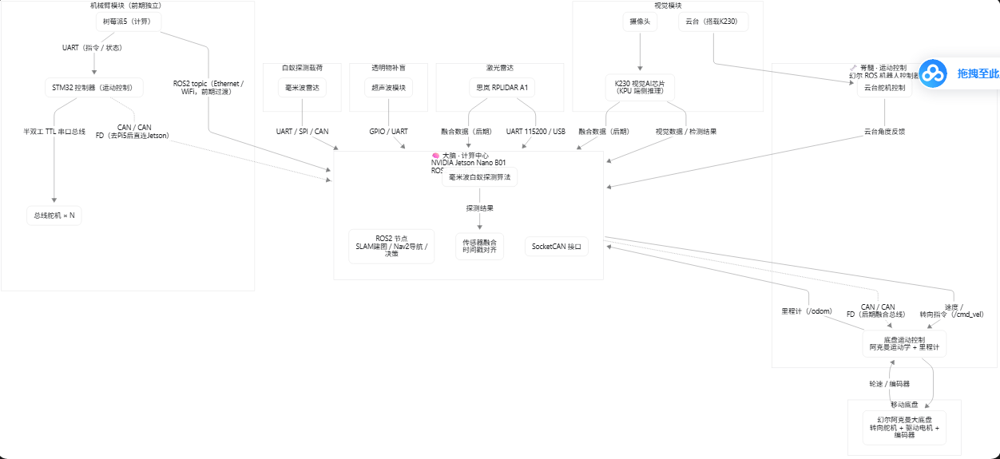

# termite-rover — 无人车白蚁探测系统

基于 **Jetson Nano B01**（ROS2 Humble 容器）的阿克曼式无人车，搭载 **60GHz 毫米波雷达（TI IWR6843AOPEVM）**、声学/低频雷达备选通道、机械臂与 K230 视觉载荷，用于木材/建筑场景的地下白蚁活动探测，并构建/标注相关数据集。

## 当前状态（2026-11-09）

| 线 | 状态 |
| --- | --- |
| **M9 毫米波白蚁探测** | ✅ 超前完成大半：自建 **747 会话 / 44 GB** 雷达数据集（4 木种 × 11 厚度档 0–50mm × 3 地点 × 0–60% 湿度），已通过全量审计（[docs/白蚁数据集审计报告.md](docs/白蚁数据集审计报告.md)）；SVD 去静杂波 + 1D-CNN **板厚回归**模型在 1100 测试窗上 MAE 5.3mm / R² 0.74；≥45mm 出现与 60GHz 穿木衰减（≈8.5 dB/cm）吻合的物理饱和——数据自证了探测的物理边界 |
| **M1 底盘自检** | ✅ 完成（幻尔控制器上电自检，舵机/急停正常） |
| **M2 Jetson 环境** | ⏳ 下一步：Qengineering Ubuntu 20.04 镜像刷机 → Docker 运行 `dustynv/ros:humble-ros-base-l4t-r32.7.1` |
| **M3–M5** | ⏳ 建图 → Nav2 阿克曼导航 → 多传感器 |

## 文档导航

| 文件 | 内容 |
| --- | --- |
| [docs/plan.md](docs/plan.md) | **核心 roadmap**：M0–M12 里程碑、架构修订表、BOM、风险 |
| [docs/todo.md](docs/todo.md) | 可勾选执行清单（Phase 0–12） |
| [docs/盘点清单.md](docs/盘点清单.md) | 硬件盘点结论 + 采购清单 |
| [docs/白蚁数据集审计报告.md](docs/白蚁数据集审计报告.md) | 747 会话数据集的全量审计（采集质量 / 标签一致性 / 配对能量检验 / 问题清单） |
| [docs/无人车白蚁探测系统-技术栈与硬件架构.md](docs/无人车白蚁探测系统-技术栈与硬件架构.md) | 原始架构文档（路线图的依据） |
| [docs/原始需求笔记.txt](docs/原始需求笔记.txt) | 项目最初需求记录 |
| [tools/](tools/) | 数据集审计与配对信号检验脚本（audit_baiyi / npz_full_check / pair_energy2 等） |

## 硬件栈

- 主控：Jetson Nano B01（Qengineering Ubuntu 20.04 + ROS2 Humble 容器）
- 底盘：幻尔阿克曼套件（官方 ROS2 包 `ros_robot_controller` + `controller`）
- 激光：RPLIDAR A1 ｜ 视觉：K230（端侧检测载荷）
- 毫米波：TI IWR6843AOPEVM（60GHz AOP）＋ HB100 10.525GHz（厚木通道）＋ 压电声学（保底）
- 机械臂：STM32F407VET6 + LX 总线舵机（双总线范式，对齐协作者 avp_robot 选型）

## 约定

- **44 GB 原始数据集存于 `E:\白蚁数据集`**，不进 git；仓库只放脚本、文档与小型分析产物。
- 所有工程改动**实时 git push**；任何人不需要也不会收到账号凭据。
