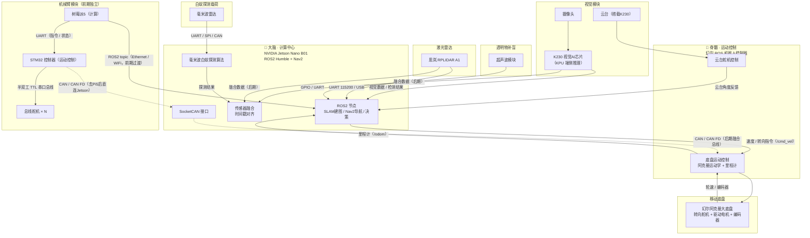

# 无人车（白蚁探测）系统 —— 技术栈与硬件架构

> 依据需求整理：阿克曼底盘 + 幻尔ROS机器人控制器 + K230视觉 + 思岚RPLIDAR A1 + 超声波 + 树莓派5/STM32机械臂 + NVIDIA Jetson Nano B01 + 毫米波雷达。
> 导航栈采用 **ROS2 + Nav2**：先固定地点 SLAM 建图，后 Nav2 自主导航；分模块梯次实现再融合。

## 1. 总体设计：大脑—脊髓模型

| 角色 | 设备 | 核心职责 |
| --- | --- | --- |
| 🧠 大脑 | NVIDIA Jetson Nano B01 | 决策、复杂处理、SLAM建图、Nav2自主导航、传感器融合、白蚁探测算法、时间戳对齐 |
| 🦴 脊髓 | 幻尔 ROS 机器人控制器 | 底盘运动学（阿克曼）解算、电机/舵机控制、云台控制、里程计回传 |
| 👁 视觉 | K230（云台搭载） | 视觉AI推理、目标/特征检测，视觉SLAM前端 |
| 📡 激光雷达 | 思岚 RPLIDAR A1 | 2D激光SLAM主传感器（建图 + 定位） |
| 🔊 补盲 | 超声波模块 | 玻璃等透明/高反物体的探测补盲（最优解） |
| 🦾 机械臂 | 树莓派5 + STM32 + 总线舵机 | 机械臂计算与运动控制（前期独立，后期并入Jetson） |
| 🐜 白蚁探测 | 毫米波雷达 | 白蚁活动探测（微多普勒/运动特征） |
| 🎥 云台 | 舵机云台（接幻尔ROS控制器） | 改变视觉姿态、扩大视野、辅助SLAM |

## 2. 硬件架构图

### 2.1 Mermaid 架构图



> 实线 = 常规数据/控制链路；虚线 = 后期融合/演进链路。

### 2.2 分层 ASCII 架构图

```
大脑 (NVIDIA Jetson Nano B01 · ROS2 Humble + Nav2)
  ├─ UART/USB ──────────────> 脊髓 (幻尔ROS机器人控制器) ──> 阿克曼底盘 (转向舵机+驱动电机+编码器)
  │                              └─ 云台控制 ──> 云台
  ├─ UART/USB/以太网 ────────> K230 视觉AI (云台搭载) <── 摄像头
  ├─ UART 115200 / USB ─────> 思岚 RPLIDAR A1 (2D激光雷达)
  ├─ UART / SPI / CAN ───────> 毫米波雷达 (白蚁探测载荷)
  └─ GPIO / UART ────────────> 超声波模块 (玻璃等透明物补盲)

机械臂（前期独立模块）
  树莓派5 ──UART──> STM32控制器 ──半双工串口总线──> 总线舵机 × N
  树莓派5 ──Ethernet/WiFi（ROS2 topic，前期过渡）──> Jetson Nano B01
  STM32   ──CAN / CAN FD（后期融合，去树莓派5）────> Jetson Nano B01
```

## 3. 技术栈

### 3.1 硬件清单

| 类别 | 设备/型号 | 角色 | 关键说明 | 主要接口 |
| --- | --- | --- | --- | --- |
| 底盘 | 幻尔阿克曼大底盘 | 移动平台 | 阿克曼转向机构 | 驱动/编码器 |
| 运动控制 | 幻尔ROS机器人控制器 | 脊髓·运动控制 | 底盘运动学、里程计、云台 | UART/USB、CAN |
| 视觉AI | 嘉楠 K230 | 视觉感知 | RISC-V CPU + KPU 端侧推理 | CSI、UART、USB、以太网 |
| 摄像头 | K230 配套摄像头 | 图像输入 | 视觉SLAM/检测 | CSI/MIPI |
| 云台 | 舵机云台（接ROS控制器） | 视觉姿态 | 搭载K230 | 舵机/PWM/串口 |
| 激光雷达 | 思岚 RPLIDAR A1 | 2D激光SLAM | 360°扫描，约12m量程 | UART(115200)/USB |
| 超声波 | HC-SR04 等 | 透明物补盲 | 玻璃等高反/透明目标 | GPIO/UART |
| 机械臂计算 | 树莓派5 | 机械臂计算（前期） | 后期可去除并入Jetson | UART、Ethernet/WiFi |
| 机械臂控制 | STM32 控制器 | 总线舵机控制 | 实时运动控制 | UART、CAN |
| 执行器 | 总线舵机 × N | 机械臂关节 | 串行总线舵机 | 半双工TTL总线 |
| 计算中心 | NVIDIA Jetson Nano B01 | 大脑 | 4核A57 + 128核Maxwell GPU | USB、UART、GPIO、CAN、以太网 |
| 探测载荷 | 毫米波雷达 | 白蚁探测 | 运动/微多普勒特征 | UART/SPI/CAN |

### 3.2 软件栈（ROS2 + Nav2）

| 层 | 选型 | 说明 |
| --- | --- | --- |
| 操作系统 | Ubuntu 22.04（Jetson Nano B01 用社区镜像；树莓派5：Raspberry Pi OS） | 官方JetPack 4.x仅到Ubuntu 18.04，Nav2需ROS2 |
| 中间件 | ROS2 Humble | Nav2 官方支持版本；rclcpp/rclpy |
| 建图 | slam_toolbox（online_async）/ Cartographer ROS2 | 固定地点在线同步建图 |
| 定位 | Nav2 AMCL | 融合 /scan + /odom + /tf 的蒙特卡洛定位 |
| 导航 | Nav2（nav2_planner + nav2_controller + 行为树 BT）+ Ackermann转向插件 | 阿克曼约束下的全局/局部规划 |
| 视觉SLAM | RTAB-Map ROS2 / ORB-SLAM3 | 视觉或视觉+激光融合 |
| 视觉AI | K230 SDK（KPU推理，YOLO/检测）；Jetson：OpenCV + TensorRT | K230端侧分担推理 |
| 毫米波处理 | 厂商SDK + 微多普勒特征提取（NumPy/SciPy） | 白蚁探测 |
| 机械臂 | 自定义运动学+轨迹规划（Python/C++）+ 串口协议 | 总线舵机控制 |
| CAN | SocketCAN + python-can / ros2 socketcan_bridge | CAN/CAN FD |
| 同步融合 | ROS2 message_filters（ApproximateTime/ExactTimeSynchronizer） | 时间戳对齐 |
| 开发语言 | C++（实时/驱动）、Python（算法/快速迭代） | |
| 工具链 | colcon、Git、rviz2、rqt、ros2 bag、launch、systemd | |

## 4. 通信接口与协议矩阵

| # | 链路 | 协议/接口 | 方向 | 阶段 |
| --- | --- | --- | --- | --- |
| 1 | Jetson ↔ 幻尔ROS控制器 | UART/USB（前期）→ CAN/CAN FD（后期） | 双向：/cmd_vel↓ /odom↑ | 贯穿 |
| 2 | 幻尔ROS控制器 ↔ 阿克曼底盘 | PWM/驱动/编码器 | 双向 | 贯穿 |
| 3 | 幻尔ROS控制器 ↔ 云台 | 舵机/PWM/串口 | 控制 | 贯穿 |
| 4 | K230 ↔ Jetson | UART/USB/以太网 | 数据上传（检测结果/图像） | 采集→融合 |
| 5 | RPLIDAR A1 ↔ Jetson | UART 115200 / USB | /scan 点云上传 | 采集→融合 |
| 6 | 毫米波雷达 ↔ Jetson | UART/SPI/CAN | 探测数据上传 | 采集→融合 |
| 7 | 超声波 ↔ Jetson / 幻尔控制器 | GPIO/串口 | 距离数据 | 贯穿 |
| 8 | 树莓派5 ↔ STM32 | UART | 指令↓ 状态↑ | 机械臂独立 |
| 9 | STM32 ↔ 总线舵机 | 半双工TTL串口总线 | 角度/扭矩指令 | 贯穿 |
| 10 | 树莓派5 ↔ Jetson | Ethernet/WiFi（ROS2 topic） | 双向 | 合并过渡 |
| 11 | STM32 ↔ Jetson | CAN/CAN FD | 双向 | 最终融合（去Pi5） |

## 5. 固定地点 SLAM 建图 → Nav2 自主导航 工作流

### 5.1 固定地点 SLAM 建图（先）

1. **底盘就绪**：幻尔ROS控制器发布里程计 `/odom`，提供 `base_link → laser` 的 TF。
2. **雷达驱动**：RPLIDAR A1 驱动节点发布 `/scan`。
3. **启动建图**：运行 `slam_toolbox`（`online_async` 模式，适合静态/低速建图）或 Cartographer ROS2。
4. **固定地点扫描**：机器人停在固定点，原地旋转 / 云台扫描，采集 360° 点云构建地图。
5. **保存地图**：`map_saver_cli -f ~/maps/<名称>` 导出 `.pgm + .yaml`。
6. **质量检查**：闭环是否完整、墙体是否对齐、有无玻璃区空洞（预留超声波补盲位）。

### 5.2 Nav2 自主导航（后）

1. **加载地图**：`map_server` 加载上一步保存的地图。
2. **定位**：启动 `amcl`，融合 `/scan + /odom + /tf` 确定机器人位姿。
3. **启动 Nav2**：`nav2_planner`（全局，NavFn/Smac）+ `nav2_controller`（局部，阿克曼运动学）+ 行为树 BT。
4. **下发目标**：rviz2 的 `2D Goal Pose` 指定目标点/目标位姿。
5. **自主导航**：全局规划 + 局部避障；超声波数据接入 costmap，补盲玻璃等透明障碍。

> TF 链：`map → odom → base_link → laser`；阿克曼底盘需在 Nav2 中配置阿克曼运动学与最小转弯半径约束。

## 6. 分阶段实施路线（分模块梯次实现 → 合并）

| 阶段 | 目标 | 关键点 |
| --- | --- | --- |
| 0 | 底盘跑通 | 幻尔ROS控制器 + 阿克曼底盘；遥控移动、里程计回传 |
| 1 | 固定地点SLAM建图 | RPLIDAR A1 → Jetson；slam_toolbox/Cartographer 建图；map_saver 保存地图 |
| 2 | Nav2自主导航 | 加载地图 + AMCL 定位 + Nav2 规划控制；阿克曼转向 |
| 3 | 视觉接入 | K230 + 云台；数据采集传回（关注丢包/掉帧）；视觉识别 |
| 4 | 视觉+激光融合SLAM | RTAB-Map ROS2 等；超声波补盲（玻璃） |
| 5 | 机械臂独立 | Pi5 + STM32 + 总线舵机；独立运动控制 |
| 6 | 机械臂合并 | Pi5 ↔ Jetson 通信（ROS2 topic）；协同动作 |
| 7 | 白蚁探测 | 毫米波雷达 → Jetson；探测算法验证 |
| 8 | 三传感器融合 | mmWave + K230 + 雷达；时间戳对齐 |
| 9 | 总线融合 + 去Pi5 | CAN/CAN FD 统一；STM32直连Jetson，去除树莓派5 |

## 7. 传感器融合与时间戳对齐

1. **统一时钟基准**：以 Jetson Nano B01 为时钟主节点（ROS2 Time）。
2. **多计算单元时钟同步**：树莓派5与Jetson之间用 chrony/NTP 对时。
3. **硬件触发同步（推荐）**：Jetson GPIO/PPS 输出同步触发脉冲给 K230、雷达、毫米波雷达，保证同一时刻采集。
4. **软件打戳**：各传感器回调内立即记录 `Header.stamp`，同时保留传感器内部时间戳。
5. **消息同步**：ROS2 `message_filters` 的 `ApproximateTimeSynchronizer`（容忍 slop）或 `ExactTimeSynchronizer`。
6. **延迟标定**：对每条链路测量固定传输/处理延迟，回写补偿时间戳。
7. **统一数据结构**：`sensor_msgs/LaserScan`、`sensor_msgs/Image`、`sensor_msgs/PointCloud2`、自定义探测消息，统一使用 `std_msgs/Header`。

## 8. 关键风险与对策

| 风险 | 说明 | 对策 |
| --- | --- | --- |
| Jetson Nano B01 与 ROS2 | 官方JetPack 4.x仅到Ubuntu 18.04，Nav2需ROS2（20.04/22.04） | 使用社区Ubuntu 22.04镜像跑 ROS2 Humble；注意CUDA/GPU驱动可能受限；条件允许建议升级 Jetson Orin Nano |
| 丢包率 | UART无校验/无流控、波特率不足 | 帧头+长度+CRC16校验；合理波特率；硬件流控；关键数据重传 |
| 掉帧 | 图像流带宽大 | MJPEG/H.264压缩；降帧率；调优 ROS2 QoS/queue；背压 |
| 透明物体 | 玻璃等使激光/视觉失效 | 超声波模块补盲（最优解），多路阵列，接入costmap |
| CAN带宽 | 点云/图像大带宽不适合CAN | CAN/CAN FD只传控制、同步触发、融合稀疏结果；大带宽走USB/以太网/UART |
| Jetson算力 | 多传感器+融合+Nav2+算法负载高 | TensorRT加速；K230端侧分担视觉推理；任务分级调度 |
| 时间戳抖动 | 非实时Linux打戳存在抖动 | 硬件触发同步；标定延迟补偿；必要时RT抢占内核 |

---

> 注：本文档为架构与技术选型方案，具体参数（波特率、CAN FD速率、舵机型号、毫米波雷达型号等）以实际器件手册为准。